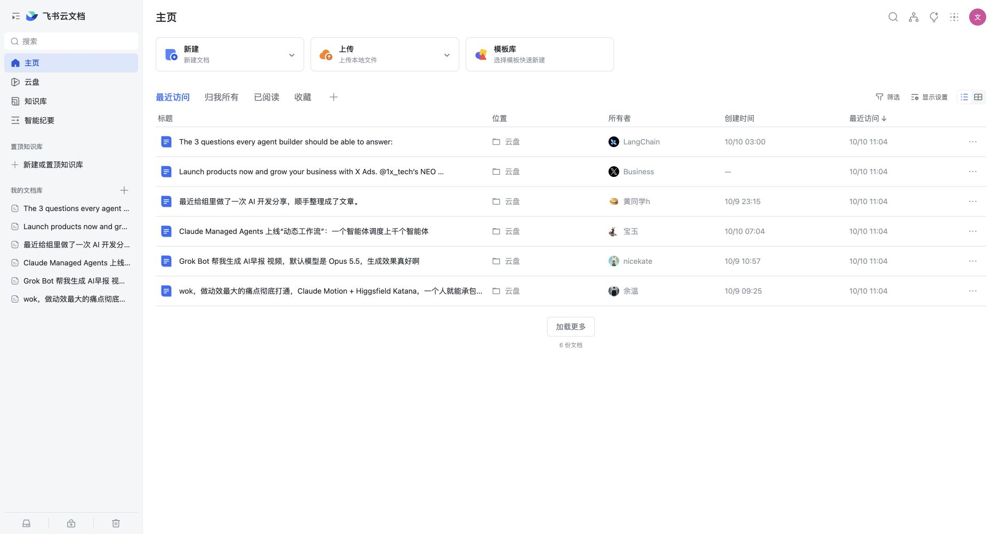
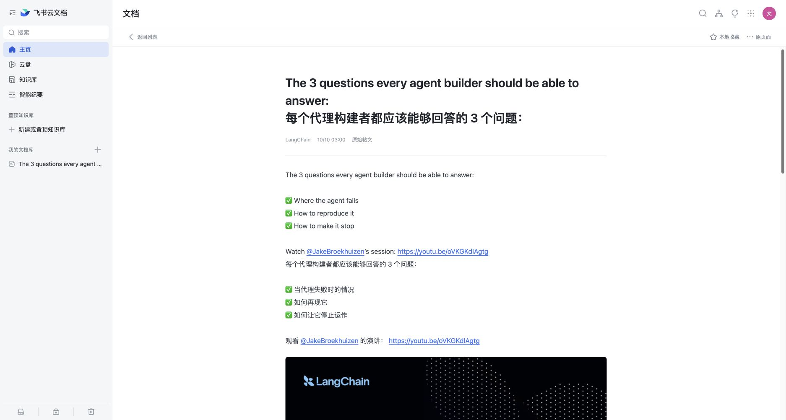
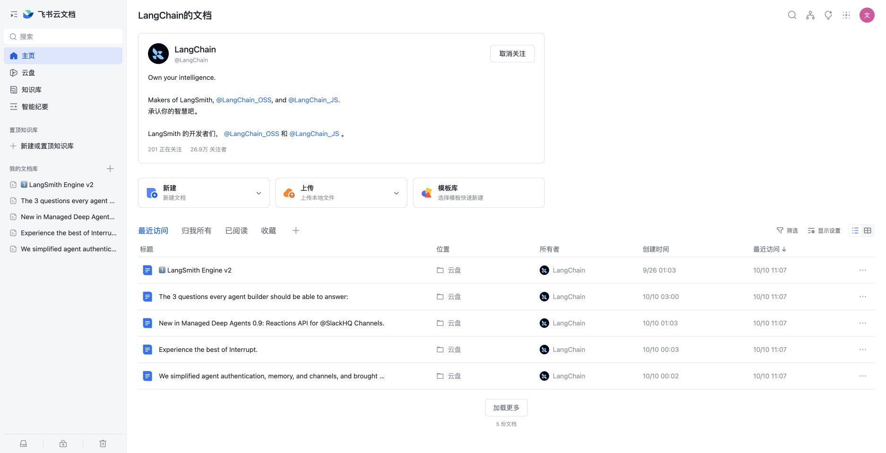

# X → 飞书云文档外观

把 X 的首页、用户主页和帖子讨论展示成飞书云文档风格。标题来自真实帖文，保留原文、引用、图片、视频和评论；操作仍由 X 原生控件执行。

**[点击这里，一键安装到 Tampermonkey](https://raw.githubusercontent.com/KAMIENDER/x-feishu-docs/main/x-feishu-docs.user.js)**

无需 clone、编译或启动本地服务。当前版本：**1.5.3**。

## 安装

1. 在浏览器中安装 [Tampermonkey（油猴）](https://www.tampermonkey.net/)。
2. 点击上方的 **一键安装**，在 Tampermonkey 页面点击「安装」。已有旧版时点击「更新」。
3. 打开并登录 [X](https://x.com/home)，刷新页面即可使用。

脚本只匹配 X / Twitter 域名。安装链接应打开油猴的确认页面；若只显示源码，检查油猴是否已启用，以及是否允许用户脚本运行。安装后没有变化时，可参考 [Tampermonkey 官方 FAQ](https://www.tampermonkey.net/faq.php)。

原来的本地安装版用户也可以点击同一链接更新。脚本名称和 namespace 保持一致，以便保留油猴中的本地笔记、收藏和设置。

如果确认页提示「即将重新安装」且已安装版本相同，请直接取消；无需重新安装，避免重置脚本设置。

## 实际截图

以下截图于 **2026-10-10** 在已登录 X 的 Edge 中截取，运行版本为 **1.4.3**。内容来自真实页面。截图中的中文译文来自当时页面已有的翻译。

**首页：真实时间线转换为文档列表**

**帖子详情：原文与原始链接**

**评论区：其他用户的原文、作者与原生操作入口**

**用户主页：简介、关注状态与帖文列表**

详情和评论截图来自 [LangChain 的真实帖子](https://x.com/LangChain/status/2108633597355630914)，主页截图来自 [LangChain 用户主页](https://x.com/LangChain)。

## 使用

| 入口 | 功能 |
| --- | --- |
| 首页文档列表 | 展示实际加载的时间线，标题取自正文首个非空行 |
| 点击标题 | 进入对应帖子详情，阅读完整的已加载正文、引用、媒体和评论 |
| 返回列表 / `Esc` | 回到来源页面，保留已加载列表、顺序、筛选和滚动位置；直接打开的帖子返回 X 首页 |
| 三点菜单 / 详情工具栏 | 回复、转帖、点赞、X 书签、浏览量、分享及作者主页 |
| 点击作者 | 打开用户主页，查看简介、帖子和当前关注状态；支持关注与取消关注 |
| 加载更多 | 连续读取 X 页面，目标每批新增 20 条，实际数量由 X 已加载内容决定 |
| 评论区 | 展示其他用户的原文、作者、时间和媒体，保留原生顺序；支持查看子讨论与加载更多 |
| 隐私模式 | 顶栏、显示设置或油猴菜单开启；图片、视频、封面和头像完全遮蔽，点击单个媒体才显示 |
| 搜索 | 筛选已读取内容；回车执行 X 搜索 |
| 新建 / 上传 / 模板库 | 创建浏览器本地笔记；上传支持 `.txt` / `.md`，不发布帖子 |
| 本地收藏 | 收藏当前浏览器中的文档，与 X 服务端书签分开 |
| `Alt + Shift + D` | 切换文档外观与 X 原界面 |
| `Esc` | 关闭图片、菜单或返回列表 |

图片可以放大预览。视频使用原始媒体或页面已有的 X 播放器。回复、转帖、关注等需要确认的操作仍保留 X 的确认流程。

隐私模式默认关闭，开关保存在油猴设置中。开启后使用强模糊加不透明遮罩，悬停不会显示内容；隐藏的视频暂停。点击「图片／视频已隐藏，点击显示」后只显示该媒体，还可点击「重新隐藏」。刷新、换帖或重新开启模式后恢复遮蔽，正文和原始媒体内容不变。隐私模式只在文档外观中生效；主动切回 X 原界面、禁用脚本或直接打开原生媒体深链接时使用 X 原有展示。

返回时恢复当前标签页的列表快照，避免退出详情后换成另一批时间线。进入帖子优先点击 X 原生链接，返回优先使用浏览器历史；屏外旧帖会先尝试恢复其原生链接。返回后点击「加载更多」继续读取后续内容。页面内最多保留 8 个路由快照，每页最多 400 条；整页导航兜底使用当前标签页的临时会话快照（30 分钟有效），不保存媒体揭示状态。主动刷新页面仍重新读取 X。

## 更新与移除

安装版已配置 `@updateURL` 与 `@downloadURL`。Tampermonkey 按你的更新设置检查新版本，也可以在它的管理面板中手动检查更新，或再次点击 **一键安装**。

禁用或删除脚本，再刷新 X 即可恢复原界面。删除前请复制需要保留的本地笔记。

## 数据与适用范围

- 读取当前页面已有 DOM，监听页面变化；不调用 X 私有 API，也不向飞书或项目作者发送帖文、账号或笔记。
- 地址栏仍显示 X。登录、注册、直接打开编辑器以及媒体深链接保留原生界面；其他未适配页面可用快捷键切回原界面。
- 只展示当前账号能够访问且 X 已加载的内容。折叠回复需要展开，推荐帖不计入讨论评论。
- 每页最多保留 400 条帖文，路由快照最多 8 页；整页导航兜底的正文临时保存在当前标签页会话中（30 分钟有效）。最多 50 份本地笔记，每份最多 500 KB；本地笔记、收藏 ID 和设置存放在油猴存储中。
- 主要适配桌面浏览器。X 页面结构变化可能需要更新脚本。原生控件尚未加载时不会虚构操作成功。

这是非官方外观脚本，与 X、飞书及 Lark 无隶属关系。内嵌图标来源与授权范围见 [THIRD_PARTY_NOTICES.md](THIRD_PARTY_NOTICES.md)。项目原创代码采用 MIT 许可，第三方图标不包含在该许可中。

## 维护

发布新版时同步修改完整脚本的 `@version` 和运行时 `host.dataset.version`，并把 `// ==UserScript==` 到 `// ==/UserScript==` 的完整头部复制到 `x-feishu-docs.meta.js`。保留脚本名称和 namespace，避免旧用户产生重复安装或丢失本地数据。

安装链接固定指向 `main` 分支的 `.user.js`，更新检查只读取 `.meta.js`。版本记录见 [CHANGELOG.md](CHANGELOG.md)，问题反馈请使用 [Issues](https://github.com/KAMIENDER/x-feishu-docs/issues)。
